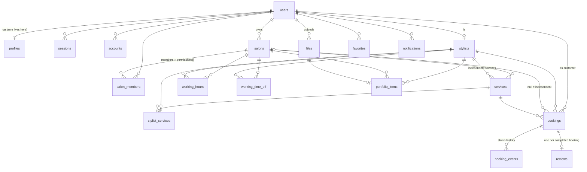

# ArayeshgahMan — Database architecture

PostgreSQL 16 · Drizzle ORM 0.45 · Better Auth 1.7 · node-postgres

## Layout

| Layer | Location |
| --- | --- |
| Drizzle schema (one file per domain) | `src/db/schema/*.ts` |
| Better Auth tables (generated by the official CLI, do not edit) | `src/db/schema/auth.ts` |
| Connection factory / app singleton | `src/db/client.ts`, `src/db/index.ts` (server-only) |
| Inferred TypeScript types | `src/db/types.ts` |
| Migrations | `drizzle/0000_initial_schema.sql` (generated), `drizzle/0001_booking_integrity.sql` (custom SQL) |
| Domain services (authorization + validation + transactions) | `src/server/**` |

## Entity relationships



* **Auth vs. application data** — `users/sessions/accounts/verifications` belong to Better Auth.
  Role and profile data live in `profiles`, so no Better Auth endpoint (e.g. `updateUser`) can change a role.
* **Stylists in multiple salons** — a stylist has one `stylists` row and any number of `salon_members`
  rows (`role = 'stylist'`). Independent work uses services/hours with `salon_id IS NULL`.
* **Working hours** are *local* wall-clock times in the salon/stylist IANA time zone
  (`day_of_week` follows `EXTRACT(DOW)`: 0 = Sunday … 6 = Saturday). Bookings and time off are absolute
  `timestamptz` ranges. Conversion happens in PostgreSQL with `AT TIME ZONE`.

## Integrity guarantees enforced by PostgreSQL

| Rule | Mechanism |
| --- | --- |
| A stylist cannot have overlapping active bookings (incl. prep buffer) — even under concurrency | `bookings_no_stylist_overlap`: `EXCLUDE USING gist (stylist_id WITH =, tstzrange(starts_at, blocked_until) WITH &&) WHERE status IN ('pending','confirmed')` (btree_gist) |
| A customer cannot hold two overlapping active bookings | `bookings_no_customer_overlap` |
| No overlapping shifts per salon/stylist/day | `working_hours_no_overlap` |
| Valid status transitions only; customer/stylist/salon/service/price immutable | trigger `bookings_guard` |
| Reviews only for the customer's own completed booking, one per booking | trigger `reviews_guard` + unique `booking_id` |
| Durations, prices, phone/slug formats, single-owner services/favorites, safe storage keys, allowed MIME types | `CHECK` constraints |

Booking state machine: `pending → confirmed | rejected | cancelled`, `confirmed → completed | cancelled | no_show`.

## Setup (local)

```bash
# 1. create a role and two databases (example; use your own password)
sudo -u postgres psql -c "create role arayeshgah_dev login password 'CHANGE_ME'"
sudo -u postgres psql -c "create database arayeshgahman_dev owner arayeshgah_dev"
sudo -u postgres psql -c "create database arayeshgahman_test owner arayeshgah_dev"

# 2. env files (see .env.example)
#    .env.local       → DATABASE_URL, BETTER_AUTH_SECRET, BETTER_AUTH_URL, UPLOAD_DIR
#    .env.test.local  → DATABASE_URL_TEST (name must end with _test)

# 3. migrate + seed
npm run db:migrate      # or: npx drizzle-kit migrate
npm run db:seed         # local DB only; dev password for all seeded users: Password123

# 4. tests (drop & recreate the *_test schema, apply migrations, run suites)
npm test
```

`btree_gist` is a trusted extension, so the database owner can create it without superuser rights.

## Commands

| Command | Purpose |
| --- | --- |
| `npm run db:generate` | Generate a migration from schema changes (`drizzle-kit generate`) |
| `npx drizzle-kit generate --custom --name <name>` | Empty migration for hand-written SQL |
| `npm run db:migrate` | Apply migrations (programmatic migrator; no drizzle-kit needed at deploy) |
| `npm run db:check` | Validate migration history consistency |
| `npm run db:seed` | Reset + seed development data (refuses non-local hosts / production) |
| `npm run db:create-admin -- <email>` | Promote an existing user to admin (the only way to create admins) |
| `npm run auth:generate` | Regenerate Better Auth tables after changing auth options/plugins |
| `npm run db:studio` | Drizzle Studio |
